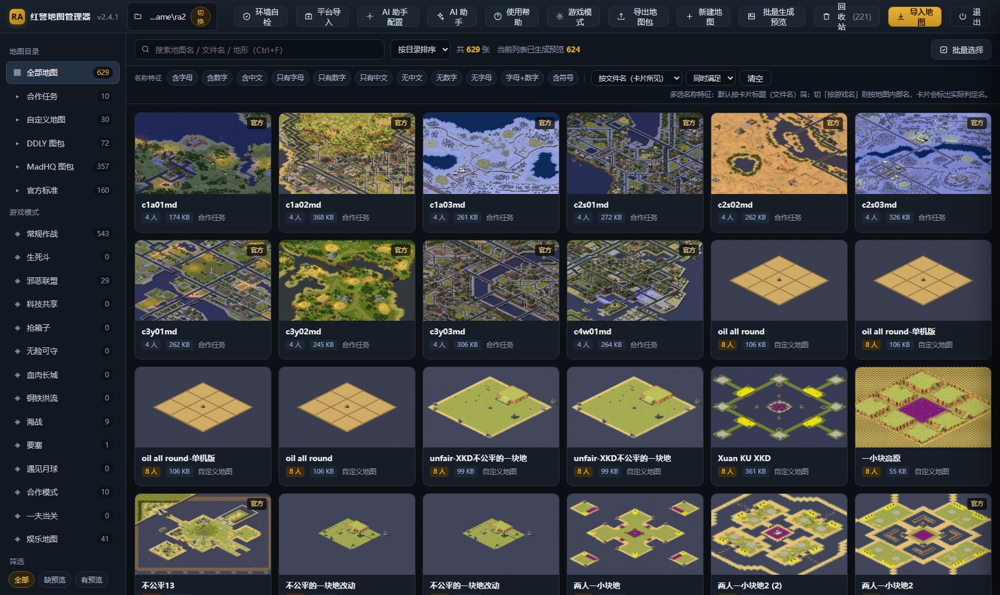
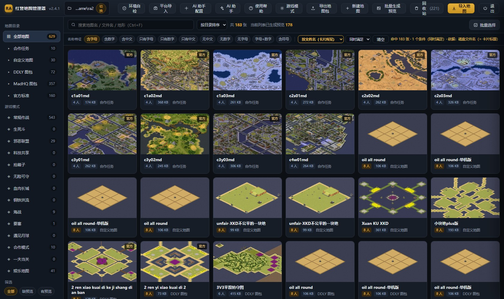
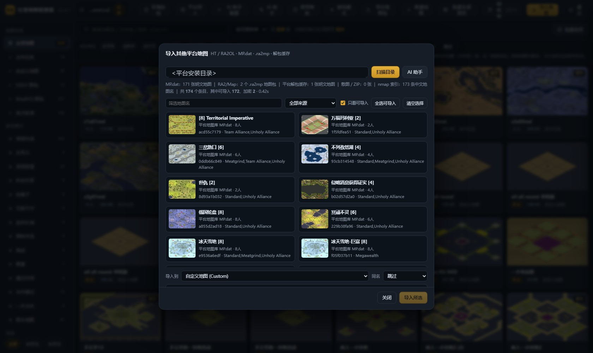
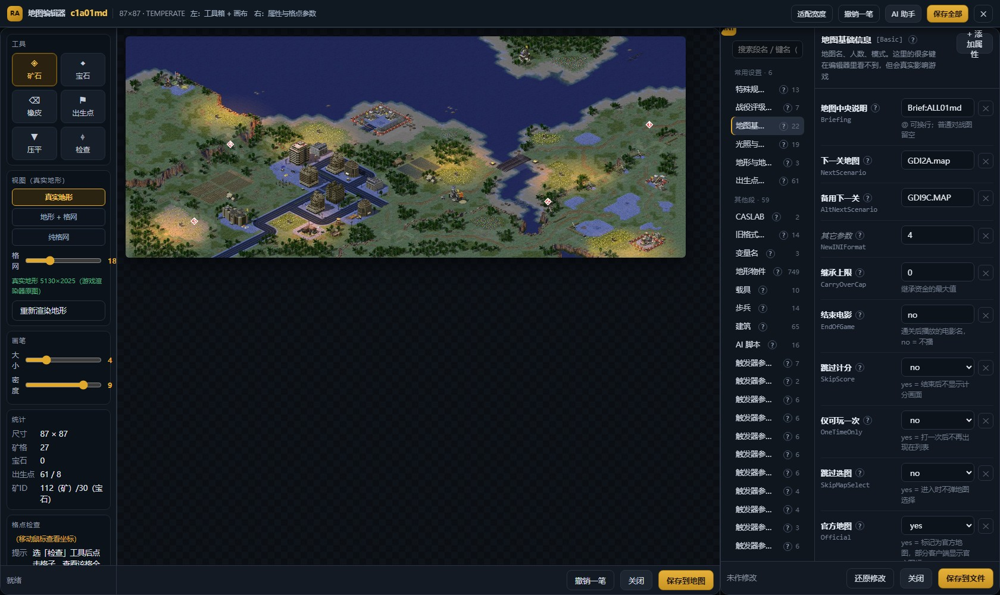
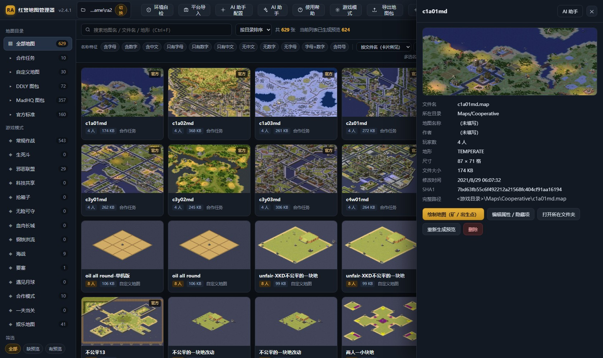
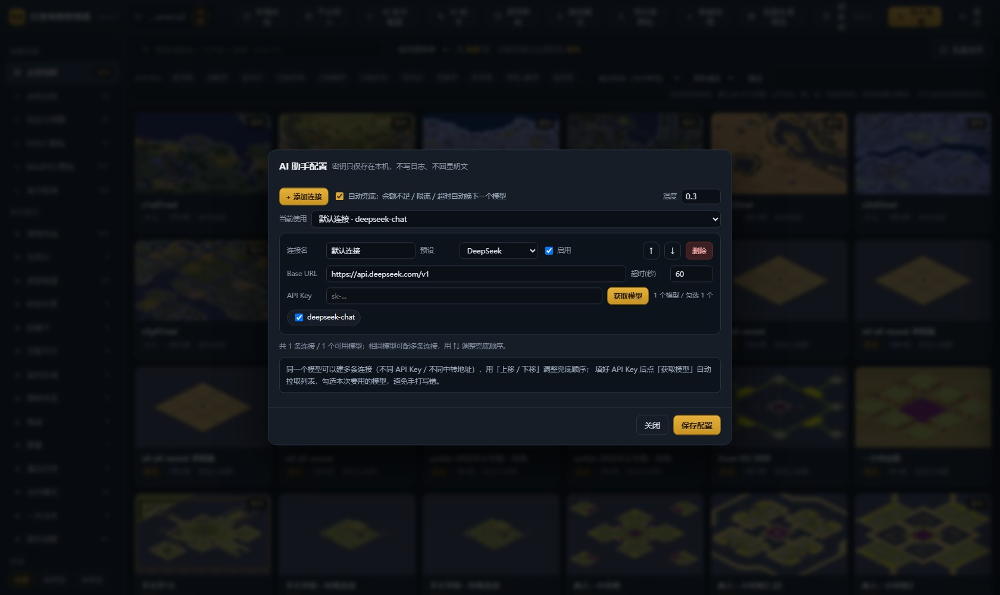
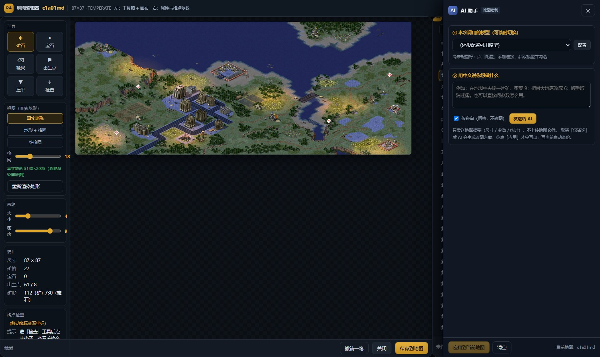

# 红警地图管理器 · RA2 Map Manager

> **不用进游戏，就能把《红色警戒 2 / 尤里的复仇》的地图看明白、管明白、改明白。**
> 单文件 exe · 纯本地运行 · 原生窗口 · 开源免费




---

## 这是什么

一个面向《红色警戒 2》《尤里的复仇》及常见 MOD（在 629 张地图样本上实测）的**本地地图管理工具**：

- **看** —— 不用进游戏就能看到地图预览、人数、尺寸、内部名、SHA1
- **管** —— 搜索 / 多选筛选 / 批量归类 / 搬目录 / 重命名 / 回收站还原 / 导出地图包
- **改** —— 改隐藏属性、刷矿刷宝石、摆出生点、取消迷雾、修坏字节
- **搬** —— 把其他平台（HTPlatform / RA2OL 类）的地图库导入到自己的整合版

程序是一个 **PyInstaller 打包的单文件 exe + pywebview/WebView2 原生窗口**，后端是本地 `127.0.0.1` 的 HTTP 服务，前端是单个 `web/index.html`。**不装 Python、不装浏览器、不联网、不写系统目录**；玩家解压双击即用，开发者可以拉源码直接改。

---

## 为什么会有它

地图攒到 600 多张以后，几个老毛病越来越烦：

| 痛点 | 本项目的做法 |
| --- | --- |
| 进游戏前不知道地图长什么样，只能靠文件名猜 | 用游戏自带的 CNCMaps 渲染器批量出真实预览图，缺预览的可一键补绘 |
| `xkdbf2`、`c1a01md`、`2 ren xiao kuai di` 这类名字在大厅里没法搜 | 名称特征多选筛选（含字母 / 含数字 / 只有字母 / 只有中文…），可切「同时满足 / 满足任一」 |
| 网上下的地图包开头被塞 UTF-16 BOM、结尾挂一行孤立的 `[`，游戏里显示 0x0 / 没预览，甚至整张图从列表消失 | 环境自检做**头 + 尾双向体检**，一键修复，原文件先备份 |
| 平台上的图格式五花八门（`MP.dat` / `.ra2mp` / 解包缓存），想搬进整合版只能手工倒 | 只读扫描平台目录，中文名从 GBK 索引还原，配好预览，勾选批量导入 |
| 刷个矿要开 FA2、改个参数要翻 INI、触发动作要背数字串 | 一个 FA2 风格同屏工作台：左工具箱 / 中真实地形画布 / 右中文参数栏 |

---

## 特性一览

| 模块 | 能力 |
| --- | --- |
| **地图库** | 目录 / 游戏模式双分类、带预览卡片墙、搜索、批量勾选、右键归类搬目录、右键「打开地图文件位置」在资源管理器里选中文件 |
| **名称特征筛选** | 搜索栏后多选 chip（v2.4 起），12 种筛选码；v2.4.1 起**默认按文件名（卡片所见）**，可切按游戏大厅名，占位名自动回退 |
| **平台地图导入** | 只读扫描 `MP.dat`（ZIP 内明文标准地图）、`.ra2mp`（元数据 + 预览）、平台解包缓存、散图与 ZIP 包；同名跳过 / 改名 / 覆盖，覆盖前自动备份 |
| **AI 助手配置** | 多条 OpenAI 兼容连接、同一模型可配不同 Key / 中转地址、填 Key 点「获取模型」拉 `/models` 并多选启用、指定当前使用 |
| **AI 助手** | 详情 / 编辑器 / 绘制 / 游戏模式 / 导入 / 平台导入 / 迷雾等模块内都能调，带模块上下文；402 余额不足、429 限流、超时自动切下一个模型 |
| **统一编辑器** | 矿石 / 宝石 / 清除 / 出生点工具，CNCMaps 输出的真实地形底图，中文参数名与 ⓘ 用法说明，触发动作中文下拉 |
| **环境自检** | 版本 / WebView2 / .NET / 渲染器逐项核对；地图坏字节头尾体检 + 一键修复；原文件先备份 |
| **其他** | 右键取消迷雾（可批量、可恢复）、导出地图包（地图 + 模式定义 + MPMaps 注册）、回收站还原、拖动分栏、右键平移画布 |

---

## 快速开始

### 方式 A：直接用 exe（推荐给玩家）

1. 下载 `红警地图管理器_v2.4.1.zip`
   - 百度网盘：<https://pan.baidu.com/s/1BV8eli3-T1HvKi8DK0Zteg?pwd=bg24>（提取码 `bg24`，目录级分享，内含「历史版本」文件夹）
   - 或本仓库 [Releases](https://github.com/smblong/ra2-map-manager/releases) 附件
2. 解压到任意目录，双击 `红警地图管理器.exe`
3. 首次启动在设置里选游戏目录（例如 `<游戏目录>`）
4. Win10/11 一般自带 WebView2；顶栏「环境自检」可一键核对

> 杀软偶尔会对 PyInstaller 打包的 exe 误报，加信任即可。程序不联网、不写系统目录。
> **本仓库不含任何地图文件、游戏本体或平台资源**，只有工具源码与文档。

### 方式 B：从源码运行（推荐给开发者）

需要 **Windows 10/11 + Python 3.11+**（`lzallright` 要求 3.11+）：

```bash
git clone https://github.com/smblong/ra2-map-manager.git
cd ra2-map-manager
python -m pip install -r requirements.txt
python ra2map.py
```

或双击 `启动地图管理器.bat`（会自动装依赖后启动）。

> 真实地形底图与预览图依赖游戏目录里的 `Resources/RandomMapGenerator_RA2/Map Renderer/CNCMaps.Renderer.exe`。
> 找不到渲染器时程序会退回纯格网底图，**其余功能不受影响**。

打包成单文件 exe：

```bash
python -m pip install -r requirements-dev.txt
python -m PyInstaller 红警地图管理器.spec --noconfirm
# 产物：dist/红警地图管理器.exe
```

---

## 界面速览

| 名称特征多选筛选 | 平台地图导入 |
| --- | --- |
|  |  |

| FA2 风格统一编辑器 | 地图详情与中文参数 |
| --- | --- |
|  |  |

| AI 助手配置（多连接 / 获取模型） | 模块内 AI 助手 |
| --- | --- |
|  |  |

> 全部截图取自 v2.4.1 在真实 629 张地图库上的实拍界面，不是示意图。

---

## 几个值得说明的设计

### 名称特征：两个名字，别选错尺子

卡片标题是**磁盘文件名**，游戏大厅里显示的是地图 INI `[Basic] Name`，629 张样本里 **447 张两者不同**。

| 筛选（629 张实测） | 按游戏名 | 按文件名（默认） |
| --- | ---: | ---: |
| 含字母 | 591 | **183** |
| 只有字母 | 125 | **100** |
| 只有中文 | 22 | **411** |
| 含数字 | 482 | **96** |

v2.4.1 起默认按**文件名**判定（所见即所得），按文件名口径的 183 / 100 张里**零张纯中文卡片**。切到「按游戏名」时，卡片会多一行「大厅名：xxx」标出实际参与判定的名字；`No name` / 空 / `unnamed` / `未命名` 等占位串会自动回退到文件名。详见 [CHANGELOG.md](CHANGELOG.md) 的 v2.4.1 条目。

### 平台地图：不破解、不伪造坏图

`MP.dat` 是 ZIP，实测内含 171 张**明文标准 .map** 与 173 张 `thumb_<hash>.jpg` 预览，中文名从 `RA2/INI/nmap.ini`（GBK）索引还原，预览按 hash 前 16 位配对（171/171 命中）。

`.ra2mp` 也是 ZIP，但 `1.txt` 是平台自有加密的地图主体 —— XOR / RC4 / AES / DES / Blowfish / zlib 常见组合都还原不出合法 INI，平台官方资料也说明「无法从外部获取地图代码」。因此本项目**不做破解**，只读取 `3.txt` 元数据与 `5.txt` 预览，把这类图标为 `locked` 并**拒绝写入**；正确通道是：在平台里开一局该图，平台会把明文落到游戏目录的 `mp.dat` / `spawnmap.ini`，再扫描「平台解包缓存」导入。宁可锁定，也不塞一张进游戏就崩的坏图。详见 [docs/平台地图导入说明.md](docs/平台地图导入说明.md)。

### AI：先给方案，确认后才写盘

AI 只生成方案 JSON，用户点「应用」才写文件；写前备份、失败整体回滚。明文 API Key 只存本地 `数据/ai_config.json`，`public_config()` 只回 `hasKey` / `keyMasked`，**永不回传明文**。配置支持多连接，`(connId, model)` 才是实际调用项，遇到可重试错误自动 fallback，不会做一半停下。

---

## 技术架构

```
┌──────────────────────────────────────────────────────────┐
│  原生窗口  pywebview + WebView2 (EdgeChromium)            │
│  ┌────────────────────────────────────────────────────┐  │
│  │  web/index.html  单页前端（原生 JS，无框架/无构建） │  │
│  └───────────────────┬────────────────────────────────┘  │
│                      │ fetch JSON  →  127.0.0.1:<port>   │
│  ┌───────────────────▼────────────────────────────────┐  │
│  │  ra2map.py  ThreadingHTTPServer + /api/* 路由        │  │
│  │  ├ mapio / mapgen / mapedit / mapfog / overlay_*    │  │
│  │  ├ ini_edit / modereg / trigger_defs                │  │
│  │  ├ platform_import   平台地图只读扫描与导入          │  │
│  │  └ ai_proxy          OpenAI 兼容多连接 + 自动兜底    │  │
│  └───────────────────┬────────────────────────────────┘  │
│                      │ 读/写（先备份、失败回滚）          │
│                 游戏目录 Maps / INI / MPMaps*.ini          │
└──────────────────────────────────────────────────────────┘
```

| 层 | 说明 |
| --- | --- |
| 前端 | 单个 `web/index.html`（约 22 万字符），两个 script 块：主逻辑挂 `window.__app`，绘制模块挂 `window.__pt`；无 npm、无构建步骤 |
| 服务 | Python 标准库 `ThreadingHTTPServer`，只监听回环地址；`/api/maps`、`/api/platform/*`、`/api/ai/*` 等 |
| 地图格式 | 标准 `.map/.mpr/.yrm/.mms` INI 文本；`IsoMapPack5`（LZO `'lit'` 字面量）、`OverlayPack`/`OverlayDataPack`（LCW）、`PreviewPack` 解析与重打包 |
| 预览 | 调用游戏自带 `CNCMaps.Renderer.exe`，Pillow 处理输出；找不到时退回格网 |
| 打包 | PyInstaller `.spec` + `version_info.txt`，`hiddenimports` 显式列出所有本地模块与 WebView2 后端 |

更多实现细节见 [docs/架构与技术说明.md](docs/架构与技术说明.md)。

### 目录结构

```
ra2-map-manager/
├── ra2map.py              主程序：HTTP 服务 / API / 地图扫描 / 启动入口
├── ai_proxy.py            AI 多连接、模型列表、自动兜底、方案生成
├── platform_import.py     平台地图库只读扫描、预览配对、导入落盘
├── mapio.py / mapgen.py   地图二进制段解析 / 生成
├── mapedit.py / mapfog.py 绘制与属性编辑 / 取消迷雾
├── ini_edit.py            INI 保序读写（含重名段、latin-1 写回）
├── modereg.py             游戏模式与 MPMaps 注册管理
├── overlay_catalog.py     矿石/宝石 Overlay ID 表（mod 相关）
├── trigger_defs.py        触发动作中文定义
├── native_win.py          Windows 原生窗口辅助
├── web/index.html         单页前端
├── docs/                  功能详解 / FAQ / 架构 / 平台导入 / 截图
├── tests/                 自包含的 API 级回归脚本
├── 红警地图管理器.spec     PyInstaller 打包配置
├── version_info.txt       EXE 版本资源
└── CHANGELOG.md           完整版本沿革
```

运行时会在程序目录下生成 `数据/`（配置、缓存、备份、回收站），已由 `.gitignore` 排除。

---

## 安全、隐私与边界

- **纯本地**：服务只监听 `127.0.0.1`；地图文件与 API Key 不上传；AI 请求只发往用户自己配置的 OpenAI 兼容端点
- **写盘先备份**：改 INI、刷矿、覆盖导入、修坏字节都会先备份，失败整体回滚
- **平台目录只读**：从不同平台目录复制明文地图，不修改平台任何文件
- **不破解加密**：`.ra2mp` 主体加密不硬解、不伪造
- **不含资源**：仓库与分发包都不附带任何地图、游戏本体、平台素材
- **明确边界**：不修改游戏可执行文件、不做联机大厅补丁、不注入进程

---

## 测试

```bash
python tests/test_v24_api.py         # API 级：平台导入 / 多选筛选 / AI 多连接与兜底（临时目录隔离）
python tests/test_v23_namefilter.py  # 名称特征筛选与右键定位（假数据，不碰真实游戏目录）
```

v2.4.1 发布前的回归结果：API **33/33**、UI **48/48**、部署版 EXE **26/26**、通用原生窗口冒烟 **PASS**。UI 测试会把 `DATA/CONFIG_PATH/META_CACHE_PATH/TRASH/TMP/BACKUP_DIR` 全部隔离到临时目录，避免污染真实配置。详见 [tests/README.md](tests/README.md)。

---

## 路线图 / 暂不做

- 暂不做：跨平台（Linux/macOS）—— 依赖 WebView2、`winreg`、资源管理器 `/select`、CNCMaps 渲染器
- 暂不做：破解 `.ra2mp` 加密主体 —— 见上文设计说明
- 暂不做：内置地图资源、在线地图库、账号系统
- 可考虑：更多平台的地图库适配、地图包格式校验增强、i18n

---

## 版本记录

当前 **v2.4.1**（EXE 文件版本 `2.4.1.0`）。从 v1.3 到 v2.4.1 的逐版更新、修复原因与实测数据见 [CHANGELOG.md](CHANGELOG.md)；首个 Release 的说明见 [RELEASE_NOTES_v2.4.1.md](RELEASE_NOTES_v2.4.1.md)。

| 版本 | 一句话 |
| --- | --- |
| v2.4.1 | 名称特征默认按文件名、占位名回退、卡片标出判定依据 |
| v2.4 | 平台地图导入 / 名称特征多选 / AI 配置与助手拆分 + 自动兜底 |
| v2.3 | 名称特征筛选（单选）/ 右键打开地图文件位置 |
| v2.2 | 地图体检扩展到头 + 尾双向，修完不再丢图 |
| v2.1 | BOM 坏头体检与一键修复 |
| v1.3 ~ v2.0 | 绘制地图、模式注册、中文参数、触发中文下拉等基础能力 |

---

## 贡献

欢迎 Issue / PR，尤其是**新平台地图库适配**和**不同 MOD 下的实测反馈**。请先读 [CONTRIBUTING.md](CONTRIBUTING.md) 与 [docs/常见问题.md](docs/常见问题.md)；提交前跑一遍 `tests/`。安全与密钥相关问题见 [SECURITY.md](SECURITY.md)。

## 致谢

- 《红色警戒 2 / 尤里的复仇》及社区 MOD 作者、地图作者
- CNCMaps 渲染器（预览图来源）、`pywebview`、`Pillow`、`lzallright`、`PyInstaller`
- 所有回帖反馈问题与实测数据的玩家

## 许可证与免责声明

本项目采用 [MIT License](LICENSE)。

**地图与游戏素材的版权归各自作者及权利人所有**，本仓库不含任何地图文件；本工具只是本地文件管理与编辑器，与游戏发行方、各对战平台无关联，非官方工具。使用第三方地图请遵守其原始授权。作者不对因误操作导致的地图/存档损失负责 —— 程序已内置备份与回收站，但仍建议自行留存副本。

> 如果这个项目帮你省了点时间，给个 ⭐ 就是最好的反馈。
